# molecule

<div align="center">
  <a href="https://www.molecule.dev"><picture>
    <source media="(prefers-color-scheme: dark)" srcset="docs/assets/how-molecule-works-dark.svg">
    
  </picture></a>
</div>
<div align="right"><small><sup><a href="https://how-molecule-works.apps.mlcl.dev">Interactive</a></sup></small></div>

## At a glance (humans and AI agents)

- **What it is.** An open-source library of 1,900+ composable `@molecule/*` packages for JavaScript and TypeScript projects, new or existing, built with Molecule or not (Apache-2.0, on npm, growing daily). Each capability (auth, database, payments, email, uploads, AI, search, PDFs, push and more) sits behind an interface, and its provider can be swapped for another vendor without changing the code that uses it. The `mlcl` CLI and the molecule MCP server let you and your coding agents find, add, wire and swap the packages; [molecule.dev](https://www.molecule.dev) adds an IDE with its own agent, Synthase, and hosted services. The code is plain TypeScript you own and can run anywhere.
- **How it works.** Find a package by capability (`npx mlcl search payments`), read its docs, and add it (`npx mlcl add @molecule/<name> --inject`): the package is installed and its provider wired in `src/bonds/`. Your code calls the core interface; a bond connects the vendor behind it. A new app can start from the packages you choose or from a template (`npx mlcl create`), or from a description in the molecule.dev IDE.
- **Set up your coding agents once.** Run `npx mlcl setup`: it asks whether to set up every project on this machine or just this one, and which of your agents (Claude Code, Codex, Cursor, Gemini CLI, Copilot, …). Each one then gets the molecule MCP server, the Molecule skills and the conventions, so it reaches for `@molecule/*` packages before writing its own.
- **Faster.** The capabilities every app needs are tested packages you add in one step, in a new app or one you already have, so nothing common is written twice.
- **Cheaper.** The integrations every app needs are packages, not tokens. Strict interfaces and READMEs generated from source let an agent wire a package in one pass, on smaller models.
- **Higher quality.** Every package is type-checked, linted and tested, with a README generated from its source. `npx mlcl check` runs a project's own typecheck, lint, build and tests and reports the first errors, so an agent fixes them before you see them.
- **Easier to maintain and scale.** Every provider (database, auth, payments, email, AI, analytics, 80+ categories) and every frontend framework (React, Vue, Svelte, Solid, Angular, React Native) sits behind a swappable bond. Change the wiring, not the app. The same architecture serves a side project and an enterprise.
- **Ready-made.** Auth and OAuth, payments, migrations, i18n in dozens of languages, analytics and telemetry, logging and monitoring, error tracking, realtime, uploads, push, search, feature flags, accessibility and CI/CD are packages, with conventions (`npx mlcl agent init`) that teach any coding agent how to use them.
- **Self-improving.** Analytics, error tracking and user feedback are packages too. On molecule.dev, the AI reads what real users do, improves the app, ships and measures again, with you approving or letting it run. The packages themselves improve from every fix.
- **If you are an AI agent.** Search before writing a capability (`npx mlcl search <capability>`), read the package's `README.md` (`npx mlcl docs @molecule/<name>`, generated from its source), call the core interface and never a vendor SDK, and add packages with `npx mlcl add @molecule/<name> --inject`, which wires their providers in `src/bonds/`. Run `npx mlcl setup` for the tooling (the MCP server, the Molecule skills and the conventions). Details below and in [AGENTS-AND-HARNESSES.md](https://github.com/molecule-dev/mlcl/blob/main/docs/AGENTS-AND-HARNESSES.md).

Open-source, composable full-stack packages that an AI can wire correctly, and real TypeScript code you can export and run anywhere. Every provider sits behind an abstract interface, so swapping the database, email, or payments provider means changing the bond that wires it, not the code that uses it.

Here is how a database provider is wired:

```typescript
import { setPool, setStore } from '@molecule/api-database'
import { pool, store } from '@molecule/api-database-postgresql'

setPool(pool)
setStore(store)
```

Swap to MySQL (or `@molecule/api-database-sqlite`) by changing the import:

```typescript
import { pool, store } from '@molecule/api-database-mysql'
```

Application code calls `@molecule/api-database` (`findMany`, `create`, `updateById`, ...), never the driver, so it does not change.

<!-- TODO(demo): 60–90s screen recording, see docs/marketing-plan.md §4 item 1 -->

Try it in a project you already have: `npx mlcl search <capability>`, then `npx mlcl add @molecule/<name> --inject`. Or describe an app at [www.molecule.dev](https://www.molecule.dev), and Synthase, the agent built into the IDE, builds it from these packages in a live sandbox.

## How it works

1. **Find a package** by capability: `npx mlcl search`, the `search_packages` MCP tool, or the [catalog](https://www.molecule.dev/packages) (1,900+ packages, all Apache-2.0, all on npm). Its `README.md` is generated from its source, so the docs match the code.
2. **Add it to any project.** `npx mlcl add @molecule/<name> --inject` installs the package and writes its provider wiring in `src/bonds/`. In a project Molecule did not create, it writes only the provider files and a setup function, and prints the one call to add at startup.
3. **Bonds wire providers** at startup. Application code only ever calls the core interface, so `npx mlcl swap` changes the vendor without touching it.
4. **Start a new app** from the packages you choose or from a template (`npx mlcl create`), or describe it at [www.molecule.dev](https://www.molecule.dev): Synthase builds it into a real TypeScript project (an Express API plus a React, Vue, Svelte, Solid, Angular, or React Native app) in a live sandbox, and deploys it when you are ready.
5. **Export anytime.** A molecule.dev project exports as one archive with the code, a database dump, and `.env` files holding the keys you own (`GET /projects/:id/export`). Unpack it and run it anywhere.

Works for enterprise, startups, and side projects. Same packages, same architecture, same tooling at every scale. Currently available for **TypeScript/Node**, with the architecture designed to expand to any language and platform.

## Why AI-first

AI coding tools work best with clean, consistent, well-documented codebases. Molecule is an AI-first composable package ecosystem, designed to be exactly that:

- **Strict interfaces**: every core package defines abstract contracts (types and signatures only), so there is no ambiguity about what to implement or how to consume it
- **Machine-readable documentation**: every package has a `README.md` generated from its source JSDoc (installation, API reference, usage examples, providers, environment variables, peer dependencies), so it cannot drift from the code
- **Deterministic patterns**: the bond system, module organization, naming conventions, and architectural rules are the same across every package. An agent that understands one understands them all.

Synthase uses this in tiers: an ecosystem overview to select packages, then the full `README.md` of each package it wires. Generated code follows the same rules as hand-written code because the rules are encoded in the interfaces. The same constraints make the codebase cleaner for humans.

## Architecture

Every design rule comes from one test:

> **"If we swapped the implementation (different provider, different framework, different database), would this line need to change?"**
>
> If yes, fix it.

### The Bond System

```
Core interface           Provider bond              Your application
-----------------        -----------------          -----------------
@molecule/api-database   api-database-postgresql    setStore(store)
                         api-database-mysql         // swap the import ^
                         api-database-sqlite        // nothing else changes
```

- **Core packages**: abstract interfaces only, zero implementation
- **Bond packages**: concrete implementations (PostgreSQL, Redis, Stripe, Mailgun, etc.)
- **`bond('category', provider)`** from `@molecule/api-bond` registers a provider at startup. Each core wraps it in a typed accessor (`setStore()`, `setTransport()`, ...) and consumers read it back through the core's own functions, never by key.
- **Normalization**: all providers for a category return the same types. `findMany()` works the same on PostgreSQL, MySQL, or SQLite.

The same pattern applies to every category a full-stack app needs, backend and frontend, from data, auth, and payments to messaging, AI, and analytics. New categories slot in the same way as the ecosystem grows.

### Three-Layer Frontend

- **Layer 1**: framework-agnostic interfaces (`@molecule/app-ui`, `@molecule/app-routing`, `@molecule/app-state`, etc.)
- **Layer 2**: framework bindings implementing Layer 1 using native idioms (hooks, composables, stores, signals, services). New frameworks added without touching existing code.
- **Layer 3**: library providers (styling, state management, etc.) wired through bonds. New libraries slot in without changing framework or application code.

Swap framework by changing Layer 2+3. Application logic stays the same.

### The N+M Pattern

Instead of N frameworks x M styling libraries (N\*M implementations), Molecule's UIClassMap collapses this to N+M. Framework UI packages use abstract class tokens. ClassMap bonds resolve them to CSS classes. Adding a styling library = one ClassMap. Adding a framework = one UI binding. Both dimensions scale independently.

### i18n and Locale Bonds

Every package with user-facing text has a companion locale bond with translations in dozens of languages. Feature packages use `t('key', values, { defaultValue: 'English' })`, no hardcoded strings. Locale bonds are pure data. Adding a language = adding translation data, no code changes.

## Using the packages

Everything here is published to npm under `@molecule/*`. Install the core for a category, install a bond for it, and wire them the way the swap example at the top does. Each package's `README.md` carries its installation, API, and environment variables.

### The molecule CLI (`mlcl`) and MCP server

The CLI finds, adds, wires and swaps packages in any project, and manages env, databases and deploys:

```bash
npx mlcl search payments                                    # find packages by capability
npx mlcl docs @molecule/api-payments-stripe                 # read a package's docs
npx mlcl add @molecule/api-payments-stripe --inject        # install + wire in one step
npx mlcl swap @molecule/api-database-mysql                 # change a provider
npx mlcl create my-app --template blog --no-interactive   # or start a new app from a template
```

For AI agents, run this once:

```bash
npx mlcl setup   # asks where (every project on this machine, or this one) and which agents
```

For each agent you choose (Claude Code, Codex, Cursor, Gemini CLI, Copilot, OpenCode, …) it registers the molecule MCP server (search, docs, add, swap, examples, checks, deploys and more, as structured tools), installs the Molecule skills, and writes the conventions where that agent reads them, so every agent prefers the molecule way. `npx mlcl mcp install` and `npx mlcl agent init` do one part for one agent. The full agent guide: [docs/AGENTS-AND-HARNESSES.md](https://github.com/molecule-dev/mlcl/blob/main/docs/AGENTS-AND-HARNESSES.md).

`npx mlcl agent init` writes the full conventions into a project's `AGENTS.md`, and every project `mlcl create` makes ships them, so any agent that opens the project understands the bond system, ClassMap styling, and handler patterns.

## Standard Tooling

Nothing proprietary, just the tools and conventions professional teams already use: strict TypeScript and ESM, npm workspaces, your choice of frontend framework, Vite, Vitest, ESLint and Prettier, semantic versioning, conventional commits, exact dependency pinning, and CI/CD that works with any pipeline. It fits your existing workflow instead of replacing it, and the toolchain keeps growing.

## Package Ecosystem

A growing ecosystem covering full-stack application concerns, with no ceiling. Every new provider, framework, or integration becomes a reusable building block for every project. Any stack, any platform, any library can be added, and the categories below are just where it stands today.

### Backend (`@molecule/api-*`)

Core interfaces and provider bonds across every backend concern:

- Data and storage
- Identity and security
- Payments and billing
- Messaging and notifications
- Background work and scheduling
- AI and agents
- Analytics and observability
- And more, added continuously

Plus typed resources, middleware, validation, testing utilities, CI/CD, staging environments, and locale packages.

### Frontend (`@molecule/app-*`)

Core interfaces and provider bonds across every frontend concern:

- UI, styling, and theming
- Routing and state
- Forms and data
- Auth and storage
- Device and platform capabilities
- And more, added continuously

Plus framework bindings for React, Vue, Svelte, Solid, Angular, and React Native, rich features like charts, maps, and rich text, and locale translations in dozens of languages.

## Add Your Service to Molecule

Want your service or integration available to every Molecule application? Open a GitHub issue describing your service and how it works. We generate a conformant bond package and open a PR for review. Once approved, it ships as part of the `@molecule` ecosystem, instantly available to every project using that interface.

- **For service providers**: describe your API and authentication flow. We handle the bond implementation, documentation, and publishing under `@molecule`.
- **For developers**: spot a missing provider or integration? Open an issue or submit a PR. The interface contracts are public, so building a conformant bond is straightforward.
- **For organizations**: you can also create private bonds for internal services, proprietary databases, or custom infrastructure using the same interface contracts and patterns.

## Analytics and Data-Driven Development

Analytics is a first-class concern, not an afterthought.

Backend (`@molecule/api-analytics`) and frontend (`@molecule/app-analytics`) use the same bond pattern. Track against the abstract interface, wire any provider (Mixpanel, Segment, PostHog, custom). Switch providers without changing tracking calls.

Track user behavior, performance, business metrics, and infrastructure health against one normalized interface. Provider-agnostic event streams let you build dashboards, alerts, experiments, and feedback loops on consistent data. Outgrow a provider, swap it, keep your instrumentation.

## Vision

### Today

A growing catalog of TypeScript packages. Six frontend framework bindings. A CLI and an MCP server that let any coding agent find, add and swap them in any project, and an IDE whose agent builds applications from them in a conversation. Machine-readable docs for every package. Usable now for real applications.

### Where It's Going

**Deeper AI integration.** The structured architecture, normalized interfaces, machine-readable docs, and deterministic patterns are built so agents can maintain and migrate applications over their whole life, not just scaffold them.

**Every language, every ecosystem.** The bond pattern (abstract interfaces + swappable providers + runtime wiring) is language-agnostic. The same architecture can power any language ecosystem with its own package catalog and provider bonds.

**Every platform.** Same composable architecture targeting mobile, desktop, edge, and any future runtime. Platform-specific code stays in provider bonds; application logic stays portable.

**Enterprise.** Private registries, organization-scoped packages, compliance bonds (SOC2, HIPAA, GDPR), security scanning, enterprise support.

**Community.** Third-party bonds, community providers, a marketplace. Universal interface contracts mean any provider package works with any application using that interface.

**Self-improving.** Every new provider bond makes every existing application more capable. Every new framework binding works with every existing ClassMap and locale bond. The ecosystem grows multiplicatively.

## Development

```bash
git clone https://github.com/molecule-dev/molecule.git
cd molecule
npm install
npm run build       # Topological parallel build
npm test            # Vitest
npm run lint        # ESLint
npm run format:check  # Prettier
```

Molecule has its own npm install so local package links in a sibling workspace can use its source without changing its dependencies.

See [CONTRIBUTING.md](CONTRIBUTING.md) for the full development workflow.

## Contributing

We welcome contributions. See [CONTRIBUTING.md](CONTRIBUTING.md) for guidelines.

## Security

To report a vulnerability, see [SECURITY.md](SECURITY.md).

## License

[Apache-2.0](LICENSE), Copyright 2026 Molecule Dev, Inc.
